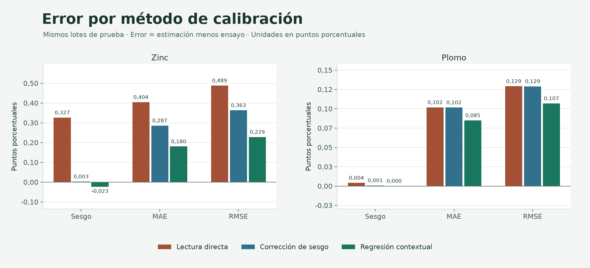

# Proyecto Veta Clara

Veta Clara es un caso de portafolio sobre un sensor espectrométrico ficticio que estima las leyes de zinc (Zn) y plomo (Pb) en dos fajas transportadoras. El objetivo es medir cuánto se desvía de los ensayos de laboratorio y si las condiciones de operación ayudan a corregir esa desviación.

El [notebook de Python](veta_clara.ipynb) muestra las celdas ejecutadas, las gráficas y su interpretación. El [script de análisis](src/analizar.py) contiene las funciones reutilizables y permite regenerar todas las salidas desde el Excel.

El conjunto se generó desde cero para esta simulación. Incluye **5.425 lotes**, del 7 de abril al 8 de junio de 2025, y **1.384 ensayos** de muestras compuestas de los mismos lotes (25,5 % de cobertura). Se simularon efectos de humedad, deriva desde la última verificación, diferencias entre fajas y ruido de medición. Las leyes se expresan como porcentaje en masa. Por ejemplo, una ley de 3,5 representa 3,5 % en masa.

## Resultados en 431 lotes de prueba

Los errores se expresan en puntos porcentuales (p. p.).

| Metal | Método | Sesgo | MAE | RMSE |
| --- | --- | ---: | ---: | ---: |
| Zinc | Lectura directa | 0,3267 | 0,4044 | 0,4885 |
| Zinc | Corrección de sesgo | 0,0030 | 0,2865 | 0,3632 |
| Zinc | Regresión contextual | −0,0234 | **0,1805** | **0,2287** |
| Plomo | Lectura directa | 0,0041 | 0,1018 | 0,1292 |
| Plomo | Corrección de sesgo | 0,0008 | 0,1017 | 0,1291 |
| Plomo | Regresión contextual | 0,0002 | **0,0850** | **0,1070** |

Frente a la lectura directa, la regresión contextual redujo el MAE un **55,4 % en zinc** y un **16,5 % en plomo**. La corrección de sesgo simple tuvo un efecto apreciable en zinc y marginal en plomo. En este último, la lectura directa ya tenía un sesgo global cercano a cero, aunque seguía presentando error por lote.



Las otras figuras muestran la [operación por faja y turno](resultados/graficos/01_operacion.png), la [concordancia frente al laboratorio](resultados/graficos/02_concordancia.png), el [sesgo por tramo de humedad](resultados/graficos/04_humedad.png) y la [proporción de lotes según la tolerancia de error](resultados/graficos/05_tolerancia.png).

## Método de validación

1. Cruzar las lecturas con los ensayos por `id_lote`. El ensayo es la referencia para ese lote y también tiene ruido simulado.
2. Ajustar con los **940** lotes medidos antes del 19 de mayo de 2025 cuyos informes ya estaban disponibles al comenzar la prueba. Se excluyeron del ajuste **13** informes de lotes previos que aún no estaban disponibles al corte.
3. Comparar tres métodos para cada metal, usando los mismos 431 lotes con lectura a partir del 19 de mayo y sus ensayos recibidos posteriormente.
   - **Lectura directa.** Usar la estimación original del sensor.
   - **Corrección de sesgo.** Restar de la lectura el promedio de sus errores en el conjunto de ajuste.
   - **Regresión contextual.** Estimar la ley de laboratorio por mínimos cuadrados con la lectura del sensor, la humedad centrada en 7 %, las horas desde la última verificación y un indicador de Faja Oeste. Truncar a cero las estimaciones negativas de los dos métodos ajustados.
4. Calcular el error por lote como ley estimada menos ley de laboratorio. El **sesgo** es el promedio de esos errores, el **MAE** es el promedio de sus valores absolutos y el **RMSE** es la raíz del promedio de sus cuadrados. Un sesgo positivo indica sobreestimación.

El desempeño corresponde a una simulación en la que el sensor y el laboratorio comparten una ley subyacente generada. Su magnitud depende de los efectos y el ruido elegidos para el escenario.

## Reproducir el análisis

Con Python 3.11 o posterior, ejecutar desde la raíz del proyecto.

```bash
python -m pip install -r requirements.txt
python src/analizar.py
```

El script usa el [Excel sintético](datos/veta_clara_sintetico.xlsx), que incluye las hojas **Guía**, **Lotes**, **Laboratorio** y **Diccionario**. Con `--excel`, `--corte` y `--salida` se pueden cambiar la ruta de entrada, la fecha de corte y la carpeta de resultados.

Para ejecutar el notebook desde la raíz del proyecto, instalar JupyterLab y abrir el cuaderno.

```bash
python -m pip install jupyterlab
jupyter lab veta_clara.ipynb
```

| Archivo | Contenido |
| --- | --- |
| [veta_clara.ipynb](veta_clara.ipynb) | Análisis paso a paso con cinco gráficas generadas por Python. |
| [src/analizar.py](src/analizar.py) | Validación de datos, ajuste de modelos y generación de figuras y tablas. |
| [resultados/metricas.csv](resultados/metricas.csv) | Métricas por metal y método en el conjunto de prueba. |
| [resultados/coeficientes.csv](resultados/coeficientes.csv) | Sesgo de ajuste y coeficientes de la regresión contextual. |
| [resultados/predicciones_prueba.csv](resultados/predicciones_prueba.csv) | Ensayo, estimaciones y errores por lote de prueba para auditar los resultados. |

